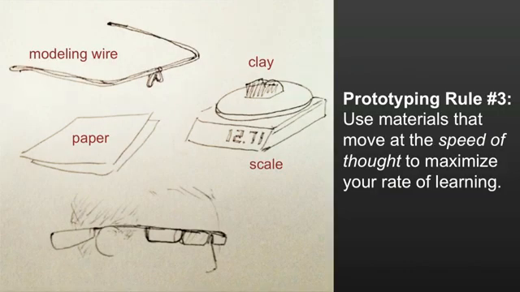

# Chapter 4: Low-fi 프로토타이핑

이제 직접 제품을 구현해 볼 차례이다. 하지만 바로 판매 또는 배포할 수 있는 수준의 제품을 만들지 않는다. 디자인팀이 현재까지 디자인한 제품이 실제로 디자인팀이 원하는 사용자 경험을 제공하는지 테스트를 할 필요가 있다. 그 첫 단계가 저충실도 (Low-fi) 프로토타이핑이다. 저충실도 프로토타이핑은 최소한의 비용으로 제품이 제공할 경험을 간접적으로 체험할 수 있는 프로토타입을 만드는 것을 말한다. 이 과정을 통해서 디자인에 문제가 없는지 기초적인 수준에서 확인을 하고 문제가 있는 경우 수정을 한다.

## 페이퍼 프로토타입

소프트웨어 제품에서 많이 사용하는 방법은 페이퍼 프로토타이핑이다. 페이퍼 프로토타이핑은 종이로 인터페이스를 구성하고, 사람이 종이 인터페이스를 직접 조작하며 소프트웨어를 프로토타이핑하는 방식이다. [한메일의 페이퍼 프로토타입 영상](https://youtu.be/GrV2SZuRPv0)을 보면 직관적으로 이해가 될 것이다. 영상을 보면 종이로 만들어진 인터페이스가 있고 사용자가 손으로 인터페이스를 조작한다. 그러면 다른 사람이 컴퓨터가 되어서 인터페이스를 바꾼다. 이러한 과정을 통해서 제품을 사용하는 경험은 어떤지, 사용성의 문제는 없는지 디자인 초기 단계에서 확인할 수 있다.

## 사용성 평가

위와 같이 페이퍼 프로토타입을 만들었으면, 프로토타입을 통하여 사용성을 평가해야 한다. 여기서 말하는 사용성은 넓은 범위의 사용성을 의미한다. 인터페이스의 문제를 파악하는 것부터 아이디어 자체에 대한 평가까지 이루어져야 한다.

사용성 평가에서 중요한 것은 다른 과정들과 마찬가지로 목적을 분명하게 하는 것이다. 그에 따라서 어떤 질문들을 해야 할지 정해지고 사용성 평가의 방식이 정해진다. 전반적인 틀은 평가 참가자가 프로토타입을 사용하게 해보고 참가자를 통해서 디자인팀은 궁금한 점들을 해소하는 것이다. 디자인팀은 참가자에게 직접적인 질문을 할 수도 있고 관찰을 할 수도 있다.

사용성 평가가 처음이라면 다음과 같은 순서로 진행해 보자. `경험커피`의 주문 화면을 페이퍼 프로토타입으로 만들었다고 가정하겠다.

1. **참가자를 모은다.** 타겟 사용자에 해당하는 사람을 5명 정도 모은다. `경험커피`라면 평일 점심에 카페를 찾는 직장인이다. [5명 정도면 큰 사용성 문제는 대부분 드러난다](https://www.nngroup.com/articles/why-you-only-need-to-test-with-5-users/). 많은 인원으로 한 번 평가하는 것보다 적은 인원으로 평가하고 고치기를 여러 번 반복하는 편이 낫다.
2. **과업 시나리오를 준비한다.** "한번 써 보세요"라고 하지 않고 구체적인 과업을 준다. 예를 들면 "점심을 먹고 동료와 함께 왔습니다. 아이스 아메리카노 한 잔과 따뜻한 라테 한 잔을 포장으로 주문해 보세요."와 같은 식이다. 이때 버튼 이름이나 조작 방법은 알려 주지 않고 달성할 목표만 말한다.
3. **소리 내어 생각하게 한다.** 참가자에게 프로토타입을 사용하면서 떠오르는 생각을 그대로 말해 달라고 부탁한다. 이것을 [소리 내어 생각하기 (Think-aloud)](https://www.nngroup.com/articles/thinking-aloud-the-1-usability-tool/)라고 한다. "포장은 어디서 고르지?"와 같은 혼잣말을 통해서 참가자가 어디에서 왜 막히는지 알 수 있다.
4. **도와주지 않는다.** 시작하기 전에 평가받는 것은 참가자가 아니라 프로토타입이라고 말해 준다. 그리고 참가자가 헤매더라도 설명하거나 힌트를 주지 않는다. 참가자가 막히는 순간이 바로 디자인팀이 찾고 있는 데이터이기 때문이다. 궁금한 점은 과업이 끝난 뒤에 질문한다.
5. **기록하고 정리한다.** 한 명은 진행을 하고 다른 한 명은 관찰한 것을 기록한다. 페이퍼 프로토타입이라면 컴퓨터 역할을 하는 사람도 필요하다. 평가가 끝나면 발견한 문제들을 모아서 심각도에 따라 나눈다. 여러 참가자가 주문을 끝내지 못하게 만든 문제와 잠깐 머뭇거리게 만든 문제는 무게가 다르다.

더 다양한 방법이 궁금하다면 앞서 소개한 '[디자인 방법론 불변의 법칙 100가지](https://product.kyobobook.co.kr/detail/S000001226665)', '[유저 리서치: UX를 위한 사용자 조사의 모든 것](https://product.kyobobook.co.kr/detail/S000001913024)'과 같은 책들을 참고하면 좋다.

## 경험 프로토타이핑

만약 제품이 물리적인 요소 (공간이나 물체)를 포함한다면 사용자 경험을 온전히 제공하는 것이 어려울 수 있다. `경험커피`의 경우에도 문제 자체가 공간과 얽혀 있기 때문에 저충실도 프로토타입을 테스트하더라도 카페 공간 내에서 실제 사용자 동선을 고려할 필요가 있다. 이런 상황에 알맞은 디자인 방법으로는 [경험 프로토타이핑 (Experience Prototyping)](https://dl.acm.org/doi/pdf/10.1145/347642.347802)이 있다. 경험 프로토타이핑은 디자인하고자 하는 경험의 단순한 버전을 쉽고 빠르게 경험하는 것이다. 그 과정을 통해서 최종적으로 디자인하고자 하는 경험이 디자인팀이 원하는 경험인지 아닌지 미리 판단을 할 수 있다. [Palm Pilot](<https://en.wikipedia.org/wiki/Palm_(PDA)>)을 만들 당시에 모바일 기기가 널리 퍼져있던 시기가 아니었기에 PDA를 사용하는 경험이 어떨지 알 수가 없었다. 그러한 경험을 _프로토타이핑_ 해보기 위해서 [Jeff Hawkins는 비슷한 크기의 나무 블록을 들고 다니면서 동작하는 Palm Pilot처럼 사용해 보았다고 한다](https://albertosavoia.medium.com/the-palm-pilot-story-1a3424d2ffe4). 구글 글래스도 [비슷한 디자인 과정을 거쳐서](https://youtu.be/d5_h1VuwD6g) 디자인되었다. [Rapid Prototyping](https://maze.co/blog/rapid-prototyping/)이라는 개념도 있는데 궁극적인 목적은 유사하다.

사용성 평가나 경험 프로토타이핑을 통해서 문제가 발견된다면, 사용자가 과업을 완수하지 못하게 만드는 치명적인 문제들이 해결될 때까지 제품 디자인을 수정하고 다시 이 과정을 수행해야 한다. 사소한 문제까지 모두 없애려고 하기보다는 문제의 심각도를 따져서 우선순위를 정하는 것이 현실적이다.

## 제약 사항 (Constraints)

제품을 만드는 상황에서도 제약 사항이 많이 생긴다. 기존에 존재하는 제품 내에서 하위 제품을 만든다고 한다면, 당연히 상위 제품에 의한 제약 사항들이 생길 수 있다. 인스타그램에서 스토리라는 하위 제품을 만든다고 생각해보자. 인스타그램 고유의 틀을 벗어나는 제품을 만들 수는 없다. 제로 상태에서 새로운 제품을 만든다고 해도 마찬가지다. 기술력이 부족할 수도 있고, 자본이 없을 수도 있고, 시간이 촉박할 수도 있다. 제품을 만들기 위한 리소스는 항상 제한적이다. 이렇게 제약 사항은 디자인에 필수불가결한 존재이다. 제약 사항 때문에 디자인을 하는 것이 어렵다고 생각하겠지만 제약 사항이 없으면 디자인도 필요가 없다. 디자인은 제약 사항 속에서 최적의 답을 찾는 과정이다.

그럼 이러한 제약 사항을 어느 단계에서 고려해야 할까? 제약 사항은 제품을 구체화해 나가는 과정에서 점진적으로 고려하는 것이 좋다. 그 시작점이 첫 프로토타이핑을 하는 과정이다. 프로토타이핑을 하면서 현재 우리가 가지고 있는 불변의 제약 사항들은 무엇인지 고민해 보고 그것을 고려해서 프로토타이핑을 해야 한다. 실제로 구글 글래스의 예시도 보면 찰흙을 이용해서 구글 글래스에 들어갈 전자 부품을 흉내 내는데 그것이 시작 단계에서 구글 글래스 디자인에 중요한 역할을 한다. 마법과 같이 기존의 안경 속에 컴퓨터와 배터리가 모두 들어간다고 가정을 하고 프로토타이핑을 하지 않는다. 하지만 그렇다고 해서 너무 디자인 프로세스 초반부터 제약 사항을 많이 고려하면 새로운 아이디어들을 전개하는 것이 어려울 수 있다. 구글 글래스의 예시를 보면 전자 부품의 무게 정도만 고려하지 어떤 모양으로 안경에 부착되어야 하는지까지는 설계하지 않는다. 그것은 이후 단계에서 결정해도 되는 것이기 때문이다. 단지 안경의 어디에 위치하는 것이 좋은지를 알아보는 정도로 그친다. 이렇게 적절한 선의 제약 사항들을 고려해서 프로토타이핑을 해야 한다. 이후 디자인 프로세스에서는 더 많은 제약 사항들을 점진적으로 적용하며 디자인을 해 나가야 한다.

