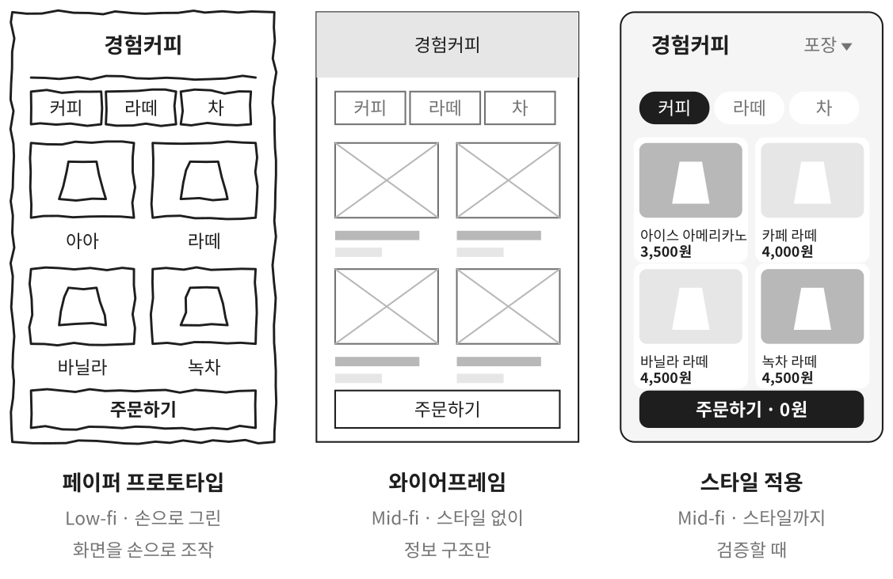
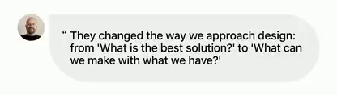

# Chapter 5: Mid-fi 프로토타이핑

저충실도 프로토타입을 통해서 제품의 기초적인 틀을 잡았다면 중충실도 (Mid-fi) 프로토타입을 통해서는 디테일한 부분을 디자인한다. 이 과정에서는 좀 더 실제 제품과 가까운 형태로 프로토타입을 만들고 사용성 평가를 진행한다. 이 과정에서는 주로 [Figma](https://www.figma.com/)와 같은 프로토타이핑 툴을 사용하는 것이 좋다. 이런 툴들은 손쉽게 코딩 없이 실제 제품과 가까운 프로토타입을 만들 수 있게 해주기 때문이다. 그렇다면 고충실도 (High-fi) 프로토타입은 어디에서 다룰까? 실제 제품과 거의 구분되지 않는 고충실도 프로토타입은 사실상 구현 단계에 가깝기 때문에 이 소책자에서는 따로 다루지 않는다. 그 대신 다음 장에서 디자인을 구현으로 넘기는 과정을 이야기한다.

이 단계에서 얼마나 실제와 가깝게 만들어야 하는지 궁금할 수 있다. 그것은 무엇을 검증해야 하는가에 따라서 달라진다. 인터페이스의 정보 구조나 컴포넌트 수준의 인터페이스 검증이 필요하다면 [스타일 없이 뼈대만 있는 인터페이스](https://www.figma.com/community/file/1075811850250564922/paper-wireframe-kit)를 사용해도 괜찮다. 하지만 만약 스타일이 사용자 경험에 중요하다고 판단이 되면 구현하고자 하는 스타일이 적용된 중충실도 프로토타입을 만들어야 할 것이다.

회사에 디자인 시스템이 있을 수 있다. 디자인 시스템은 색, 글꼴, 버튼 같은 인터페이스 요소를 일관되게 쓰기 위해 정리해 둔 규칙과 컴포넌트 모음이다. 디자인 시스템이 없더라도 이미 만들어 둔 인터페이스 컴포넌트들이 존재할 수 있다. 그러한 재료들을 사용하면 중충실도 프로토타입을 쉽고 빠르게 만들 수 있기 때문에 사용하고 싶을 것이다. 하지만 이 단계에서는 그러한 재료를 사용하지 않는 것을 추천한다. 앞에서 스타일이 중요하다면 스타일을 적용하라고 한 것과 모순처럼 들릴 수 있다. 하지만 검증하려는 부분에 필요한 만큼만 스타일을 직접 입히는 것과, 이미 완성된 컴포넌트를 그대로 가져다 쓰는 것은 다르다. 완성된 컴포넌트를 가져오면 아직 정해지지 않은 부분까지 포함해서 인터페이스 전체가 완성품처럼 보이기 때문이다. 중요한 것은 미완성인 부분은 미완성처럼 보여야 한다는 점이다. 기존 재료를 추천하지 않는 이유는 두 가지다. 첫째, 프로토타입이 완성품처럼 보이면 피드백을 주는 사람이 어디까지 바꿀 수 있고 어디부터 바꿀 수 없는지 알기 어렵다. 그러면 바꾸고 싶은 부분이 있더라도 이미 완성되어 보여서 의견을 주지 않을 수 있고 폭넓은 피드백을 받기가 어렵다. 둘째, 기존에 있는 틀에 얽매이게 되어서 더 나은 디자인이 나오지 못할 수 있다. 충분히 고민을 할 수 있는 기회가 사라지는 것이다. 이것은 [디자인 시스템이 가지고 있는 한계점](https://youtu.be/BQXTt-NZ2Bs) 중 하나이다. 이 단계는 충분히 자유롭게 인터페이스를 탐색해 보고, 기존의 디자인 시스템에 한계가 드러난다면 개선을 결정해야 하는 단계이다.

## 사용성 평가

중충실도 프로토타입을 사용해서도 사용성 평가가 필요하다. 이 과정에서는 저충실도 프로토타입 사용성 평가보다 좀 더 디테일한 부분의 사용성을 평가해야 한다. 과정 자체는 저충실도 프로토타입과 크게 다르지 않다. 다시 한번 강조하지만, 이 단계에서 사용성 이슈가 발견이 되면 다시 돌아가서 프로토타입을 개선하고 사용성 평가를 반복해야 한다.
