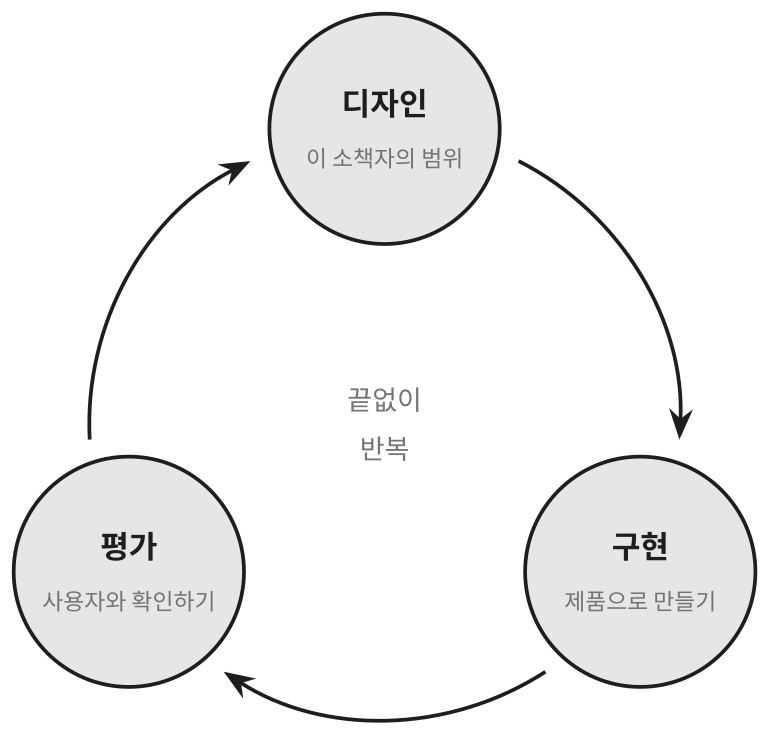

# 끝없는 과정

리포트까지 작성하고 나면 끝이라고 생각할 수 있다. 하지만 제품을 만드는 과정은 끝없는 과정이다. 제품을 만드는 과정을 단순하게 이야기하면 디자인, 구현, 평가 이 세 단계를 끊임없이 반복하는 것이다. 앞에서 리포트로 마무리 지은 단계는 한 번의 사이클을 완주한 것이라고 보면 된다. 분명 모든 단계를 수행하더라도 제품에는 다양한 사용성 또는 기술 문제가 있을 수 있다. 그럴 때마다 디자인, 구현, 평가의 단계를 반복하면서 제품을 개선해 나가야 한다.

그렇기 때문에 이 소책자를 덮고 해야 하는 것은 다시 첫 단계로 돌아가는 것이다. 지난하지만 지겨워질 때까지 반복하다보면 비로소 쓸 만한 제품이 나올 것이다.
