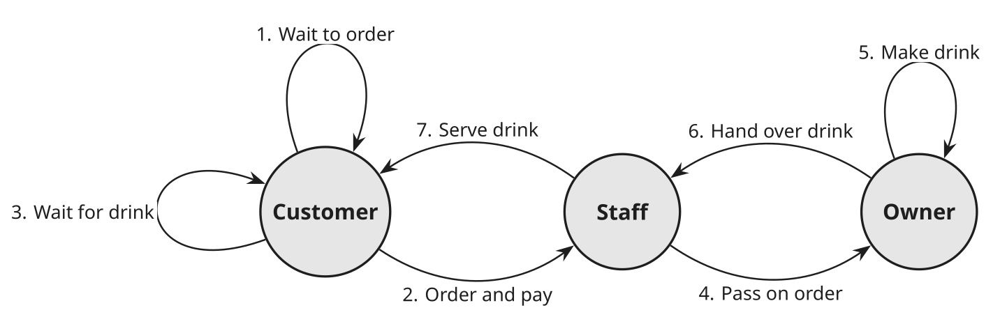

# Chapter 1: Understanding the Situation

A design team always builds a product within some situation, and that situation sets the boundaries of the product. You might build a product within your company's service, or build one as you start a company. The situation gives the basic frame of the product the design team needs to build. For example, a commerce company might build a review system, and a social media company might build an interface for short-form content. Even when you start a company, you'll do so with a basic direction already in place. For example, a founder will have a problem in mind, such as solving a city's traffic problems or making food delivery more convenient, and that problem sets the basic boundaries of the product.

You can also think of these boundaries as the context, and product design starts with understanding this context. Put more simply, understanding the context means building basic knowledge of the domain that the product the design team wants to build belongs to. To make this easier to follow, this booklet uses the process of building a fictional product for a fictional company as an example.

A café called `Experience Coffee` wants to install a kiosk to handle orders more efficiently. `Experience Coffee` is an independent café, not a franchise, and since there are many offices nearby, it gets very crowded at lunchtime on weekdays. At other times it is quiet. Now let's understand the context of `Experience Coffee`. You are the only product designer at `Experience Coffee`, and your job is to design its kiosk product.

## Understanding the context

There is no set way to understand the context; it varies greatly with the domain and the situation. But in every situation, you need to acquire domain knowledge and identify the stakeholders.

### Acquiring domain knowledge

It's important to have domain knowledge about the product the design team wants to build. Domain knowledge may sound vague, but it means knowledge of the industry, the work, and the environment the product will be used in. Asking questions like these is useful for building domain knowledge:

- What products are similar to the one the design team wants to build?
- If the company already has a product that plays a similar role, what state is that product in?
- What are some cases where the problem the design team wants to solve has been solved?

Through this process, you can figure out which problem to focus on, and you can avoid [reinventing the wheel](https://dictionary.cambridge.org/dictionary/english/reinvent-the-wheel). Time is not unlimited, so if existing cases have parts that are well designed, you should borrow them as they are.

What you need to be careful about is not being too biased by existing cases. You should borrow only the good design from existing cases; repeating their mistakes is a problem. Finding the balance between the two is important. Let's think about it with the `Experience Coffee` case. You can build domain knowledge by answering questions like these:

- What features do café kiosks usually offer?
- Have nearby cafés that introduced kiosks become more efficient at handling orders?
- How much does it cost to run a kiosk, and how many customers' orders can a kiosk usually handle per hour?
- Is kiosk interface design the same regardless of the type of business? Are there features that café kiosks specifically need?
- What research papers have studied the usability of kiosks?
- Do most cafés use kiosks?

### Understanding stakeholders

[Stakeholders](https://www.nngroup.com/articles/stakeholder-analysis/) are all the groups connected to the product. Teams within the company that are connected to the product are stakeholders, and so are customers. But at this stage, it's important to identify the stakeholders within the company. A single product can affect the work of many people in the company or the team. And as the project goes on, there will certainly be decisions where their opinions need to be taken into account. That's why it's important to know which stakeholders exist and what their roles or areas of expertise are.

Once you have identified the stakeholders within the company, it's good to interview them to build domain knowledge. Going through stakeholders is an efficient way to gain knowledge. You can ask them directly about what you want to know, and you can get insightful answers based on their experience and knowledge.

In the `Experience Coffee` case, the stakeholders would be the owner and the part-time staff. First, you talk to the owner. The owner has asked you to design a kiosk, but business isn't going that well, so the owner isn't sure whether they can afford a large kiosk. On top of that, the café is very cramped, and there doesn't seem to be room for a large kiosk. But listening to the owner and the staff, you find that taking orders and making coffee with just two people at weekday lunchtime is overwhelming. Through the conversation, you learn that the kiosk the owner mentioned is only one suggestion: as long as the two of them can handle the rush of orders, it doesn't matter whether a kiosk is used or not.

### Setting the target users

It's also good to decide at this stage who you are building the product for. It may be narrowed down further in later stages, but you need to set the overall direction. If there is an underlying service, the target could be whether the product is for new customers or existing customers, or which existing customers with certain characteristics it is for. If you are targeting entirely new customers, you can also decide which situation the users you are targeting are in.

The company's situation or your own values can influence this process. If the company currently needs to focus on new customers, new customers will be the target. Building a service for older people is certainly worthwhile, but if your main customers are young people, they should be your target customers.

So who are the target users of the `Experience Coffee` project? Customers come to `Experience Coffee` at all times of day, but in this project, the target users will be office workers who come at weekday lunchtime. Other customers matter too, but it's fine not to worry about them for now. Meanwhile, don't forget that the staff and the owner, who take and fill customers' orders, are also users of this product. They are secondary users, and they affect the product's success as much as the customers placing orders. Secondary users are users who don't use the product directly but use what it produces. In this case, customers order their drinks themselves, so they are the primary users, and the staff take the orders, so they are the secondary users.

## Check: a UX blueprint sketch

How can I tell whether I have really understood the landscape the product sits in before building it? If you can explain how the service your product provides is structured, you can say you understand it to some degree. What I mean here is the structure from the user experience point of view. I call this a UX blueprint; it is also called a [service blueprint](https://www.nngroup.com/articles/service-blueprints-definition/). The image below is a sketch of the UX blueprint of `Experience Coffee`.

I call it a UX blueprint rather than a service blueprint because sometimes you need to understand the structure of an experience itself rather than a service. For example, if you are building a product that improves the experience of giving and receiving gifts, you need to draw a blueprint of how people currently give and receive gifts.

You can analyze the whole system as in a UX blueprint, but you can also analyze it with a focus on individual users. This is usually expressed as a [user journey map](https://www.nngroup.com/articles/journey-mapping-101/). A user journey map visualizes the process through which one user goes through a particular experience. In some cases, a user journey map is more useful.
