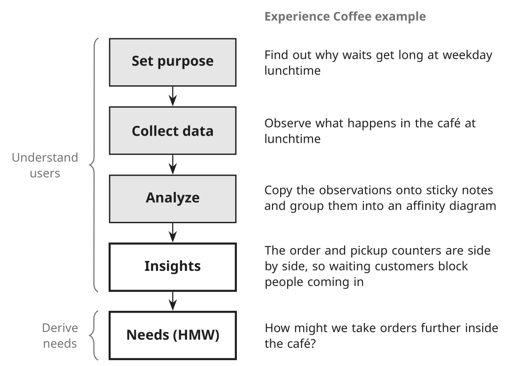
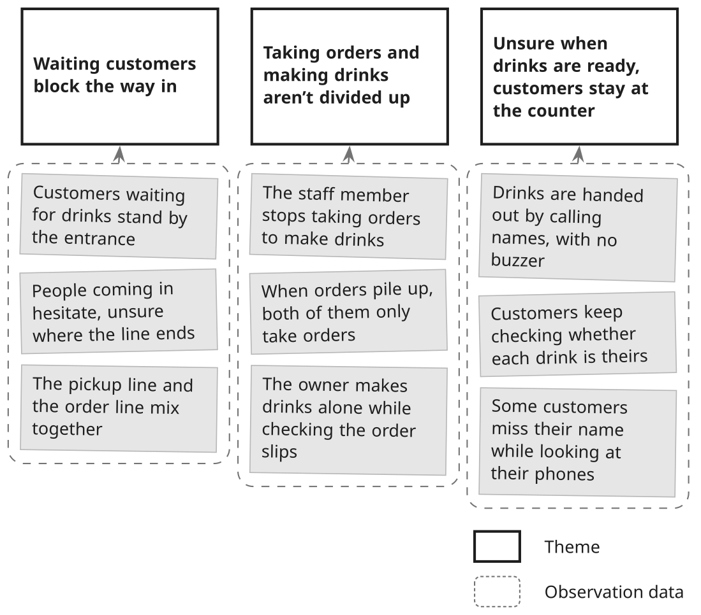
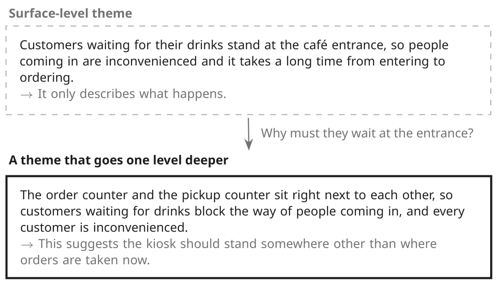
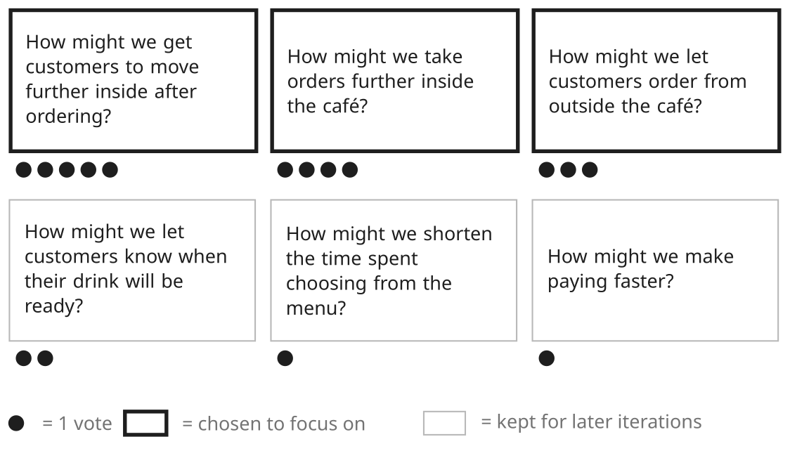

# Chapter 2: Deriving Needs

You can only build a product that is useful to users if you know their needs. To derive users' needs, you first have to understand the users. So this chapter mostly talks about how to understand users. If Chapter 1 was about understanding the big picture, this is the process of understanding the details. Understanding users is a vast topic, and there are a great many design methods for it. So in this chapter, I talk only about simple, intuitive, common methods, and point to material where you can learn more for the details.

## Understanding users

Concretely, understanding users means understanding why users act the way they do, in the context they are in. As I said above, there are so many possible ways to do this that there is no one set method. You have to understand users in the way that best fits the situation. It may feel daunting to start, because this process is exploratory. The design team has to start without knowing what to observe or investigate, and that is natural.

The process has three steps. First, make clear why you want to understand the users. Then collect data that helps you understand them. Then analyze the data to derive insights about the users. These insights are then used to derive needs. Understanding stakeholders works the same way. Understanding users and understanding stakeholders can happen in parallel or one after the other.

### Setting the purpose

The first step is deciding the purpose of understanding the users. In other words, deciding from what point of view you will look at the users. Let's use the `Experience Coffee` example. One possible purpose is "find out why waits at Experience Coffee get long at weekday lunchtime." This was the café owner's point of view. But you could also look at it more from the customers' point of view. Then "find out the problems in the user experience caused by long waits" could be another purpose.

This may sound contradictory. Don't you need to understand the users first in order to set the purpose of understanding them? How can you know what matters and set a purpose when you know nothing about the users? Isn't this a chicken-and-egg problem? You might think so, but in reality it's impossible to understand users without any purpose, that is, starting from a blank slate. You may want to understand users without any bias at all, but that is impossible. That idea comes from a model in which there is unchanging "knowledge" about users and the researcher's job is to find it. It is more accurate to say that "knowledge" only arises when we have a "point of view."

Here is an analogy. Suppose there is a cup in a room, and the lights suddenly go out so you can no longer see it. You could say the cup might as well not exist. In this way, we need light (a point of view) to see the cup (knowledge). And the color of the cup changes with the light. Under daylight it will look white, and under warm light it will look yellowish. Just as the color of the cup changes with the color of the light, there is no absolute knowledge about users, only knowledge that arises from a point of view.

For this reason, this booklet uses the term "need-deriving" instead of the more common "[needfinding](https://hci.stanford.edu/courses/dsummer/handouts/NeedFinding.pdf)."

Also, the purpose you set at this stage shouldn't be too narrow. Deriving needs is an exploratory stage, and with a narrow purpose you may end up exploring only a narrow area. To do this well, you need to have built up your domain knowledge in the previous stage. You need a sense of where the important problems might lie to set a good purpose. But don't put too much pressure on yourself. Because the purpose isn't narrow, even if you head in the wrong direction at this stage, there's a good chance you'll find the right direction later. And you can always come back and set the purpose again.

### Collecting data

There are many ways to collect data. You can interview users directly or run a survey. Shadowing means following users around and observing what they actually do, and fly-on-the-wall observation means watching users behave as usual without the observer stepping in. Whatever the method, when you observe or record people, tell them the purpose beforehand and get their consent. Especially if you take photos or video, always get consent, and don't use the data you collect for anything other than the stated purpose. It's hard to introduce every method here, so I'll recommend some books and material that are worth consulting.

- *Universal Methods of Design* by Bella Martin and Bruce Hanington: This book describes many methods. It's good to borrow the methods that fit your situation, or to create new ones.
- *User Research* by Stephanie Marsh: A comprehensive and detailed book on user research as a whole, not just data collection methods.
- [*Research Methods in Human-Computer Interaction* (2nd ed.) by Jonathan Lazar, Jinjuan Heidi Feng, and Harry Hochheiser](https://www.amazon.com/dp/0128053909): Introduces data collection methods covering both quantitative and qualitative research in great detail.

You don't need to memorize all the methods, but it's useful to keep a rough idea of what's out there. It can work like a toolbox you can pull out when you need it. But don't confuse a method with a "process." That is, a method doesn't come with fixed rules you must follow. You'll often modify or combine methods. Focus on achieving the purpose, not on following the method.

Let's go back to the `Experience Coffee` example. If the purpose of understanding the users is "find out why waits at Experience Coffee get long at weekday lunchtime," let's think about what data to collect, and how, to achieve it. Long waits are a collective phenomenon. They're not about any one person's experience but about the sum of a group's experiences. It's the customers who come later, not the first ones, who experience long waits, and waits don't get long at one particular moment but grow gradually as the peak time approaches. So in this case, rather than interviewing individual customers, you would need to observe what happens inside `Experience Coffee` at lunchtime. If the purpose were "find out the problems in the user experience caused by long waits," methods such as interviews or surveys to learn about the experiences of customers worn out by long waits would be appropriate.

### Analysis

Analysis has even less of a set form than data collection. Analysis means finding patterns in the collected data and drawing out what those patterns imply. There are many ways to find patterns, and one of the most common is [qualitative coding](https://atlasti.com/guides/qualitative-research-guide-part-2/data-coding). Simply put, you assign codes to the meaningful parts of the data you collected, and find patterns based on these codes. The codes themselves can be patterns, or you can find further patterns among the codes.

Coding properly isn't easy. Not only creating codes but also managing them is hard in practice. You'll find that coding without a suitable tool is a hassle. Having several people assign codes to data, which usually exists as text, isn't convenient in an ordinary text editor. That's why tools such as [ATLAS.ti](https://atlasti.com/) exist. There are also free, open-source tools such as [Taguette](https://www.taguette.org/).

Here I introduce a quicker, quick-and-dirty way to find patterns: drawing an [affinity diagram](https://www.nngroup.com/articles/affinity-diagram/) directly, without coding. An affinity diagram groups a set of items under similar concepts. Analysis with an affinity diagram works like this:

1. Turn the text data into items. Cut out the parts that seem meaningful and copy them onto sticky notes.
2. Build an affinity diagram from these pieces of data.
3. Find the common theme of each group.

What you need to watch out for here is that the themes you derive shouldn't be superficial. They should be written so that, looking at a theme, the users' needs follow intuitively. Let's use the `Experience Coffee` example again. A theme like "Customers waiting for their drinks stand at the café entrance, so people coming in are inconvenienced and it takes a long time from entering to ordering" is superficial, because it only describes what happens. You need to go one level deeper and analyze why customers have no choice but to wait at the entrance. In the `Experience Coffee` store layout, the order counter and the pickup counter are side by side. "The order counter and the pickup counter sit right next to each other, so customers waiting for drinks block the way of people coming in, and every customer is inconvenienced" is a better theme. In terms of the UX blueprint sketch in Chapter 1, customers at the "wait for drink" step are blocking customers at the "wait to order" step. This theme implies that if a kiosk is installed later, it should be in a different place from where orders are taken now.

You can also think of a theme as a "hypothesis with evidence." From the point of view of the scientific method, it's hard to say the themes are true. They are closer to hypotheses. The data collected at this stage usually isn't collected to test the themes but under a broader purpose, and such data isn't enough to test them. For example, to rigorously test whether having the order counter and the pickup counter next to each other at `Experience Coffee` is the main cause of the bottleneck, you would have to do the following. First, observe whether the bottleneck disappears when the order counter is moved, and measure, for every customer, the time from entering to ordering and from ordering to getting the drink, then compare and analyze them. When deriving themes, you made observations with little specific aim; when testing a hypothesis, you have to measure clear metrics. The approach is completely different.

Then you may wonder whether it's all right to treat these themes as if they were true. If all the themes are hypotheses, shouldn't they all be tested? No. In practice, testing every theme with scientific methods takes far too much time and effort, and in many cases testing isn't necessary. If you were doing academic research, it might be a good approach. But the design team's goal is to build a product, not to produce knowledge. So rather than putting effort into testing whether the themes are really true at this stage, it's more efficient to assume they are true, design the product, and then test the design. Moreover, since the themes weren't created out of nothing but derived from data, you're not very likely to end up with a meaningless design.

The themes derived this way can be seen as insights, and these insights are the output of understanding users. Through the process so far, the design team can be said to understand the users to some degree.

## Deriving needs = defining the problem

Based on the insights derived above, you derive needs. A useful technique at this stage is "[How Might We (HMW)](https://www.nngroup.com/articles/how-might-we-questions/)." Setting feasibility aside and assuming you can build anything, you write down what the design team could do to achieve the purpose, and then choose which of these the design team should focus on. HMW questions usually start with "How might we" and end with a question mark. Examples might be:

- "How might we get customers to move further inside after ordering?"
- "How might we take orders further inside the café?"
- "How might we let customers order from outside the café?"

It's important to write HMW questions that are neither too broad nor too narrow. If a solution is already built into the question, like "take orders further inside the café" in the second example, it closes off other possibilities in advance. If a solution comes to mind first, take a step back and rewrite, as a question, the problem that solution is trying to solve.

An HMW question is both a user need and a problem the design team has to solve. You can derive HMW questions through the following process:

1. Prepare a number of sticky notes or blank cards.
2. On each card, write something that could solve the problem.
3. Build an affinity diagram from the cards.
4. Vote together. (One person may vote for more than one card.)
5. Pick out the few HMW questions the vote judged important.

There is no set number of HMWs to pick. But obviously, you shouldn't pick too many. It's better to focus on only a few problems in the design process. Still, it's useful to keep the needs that weren't picked rather than throwing them away. These HMWs can come in handy when improving the product after it's designed. When you improve the product, you can also start again from this stage. This process is described in detail in the book *Sprint*, which is worth consulting.
