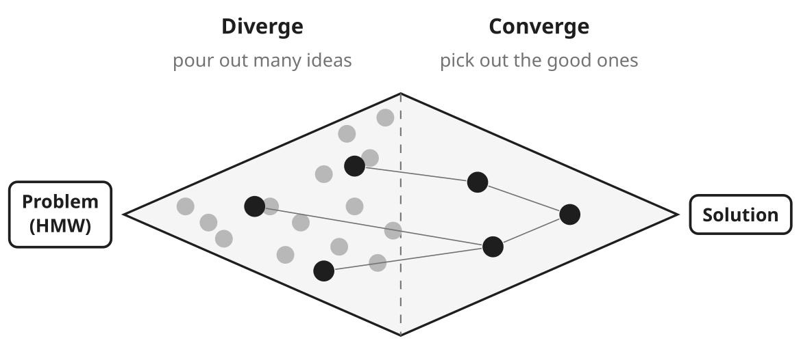
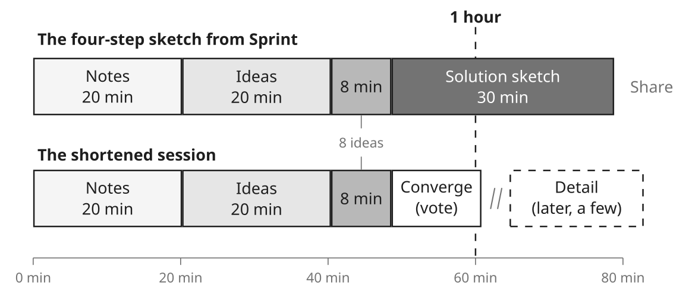
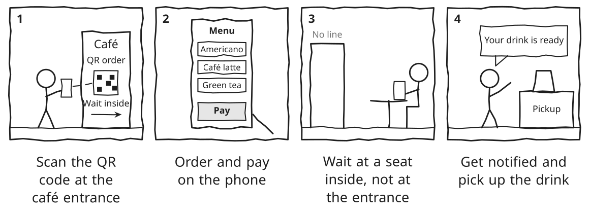

# Chapter 3: Sketching Solutions and User Experiences

This is the stage where you pour out creative ideas and find a good product concept by communicating through sketches. You think about what product could solve the problem discussed earlier (the solution), and check whether the picture of the problem solved through that product is what we want (the user experience).

## Sketching solutions

Coming up with solutions is a process that calls for creative thinking. There are many methods that help with creative thinking. You can use [creative toolkits](http://designmethod.korea.ac.kr/design-method/creative-toolkit/) (in Korean) or techniques such as [bodystorming](http://designmethod.korea.ac.kr/design-method/bodystorming/) (in Korean). But a more fundamental approach than these techniques is **divergence and convergence**. Divergence is the process of pouring out many ideas, and convergence is the process of picking out the good ones. Design methods of all kinds make these two processes easier. It's good to borrow or create various techniques under the frame of divergence and convergence and try them out.

The book *Sprint* presents a useful method called the `four-step sketch`. It has four steps: first, gather the key information for 20 minutes; then think of rough ideas for 20 minutes; then flesh out eight different ideas in 8 minutes (Crazy 8s); and finally, create one more detailed solution in 30 minutes. After that, everyone shares their ideas.

The drawback of this method, though, is that the session gets long. In *Sprint* it's designed this way because sessions run for five full days, but in ordinary situations people lose focus once a meeting runs past an hour, or a meeting of more than an hour may be hard to hold at all. This is especially true when many people take part.

In that case, you can modify the process slightly. Go only as far as the step of making eight different ideas, and then converge on the opinions of the many people in the session. To converge, you can use an affinity diagram or a vote. After that, a few people can focus on fleshing out the ideas at a separate time. When you're not running a sprint, this method may be more realistic.

A sketch should be sketchy. It shouldn't take much effort and should be easy to throw away, but it should express the core idea. You could go as deep as you like on sketching, too. If you're curious about the importance and role of sketching, I recommend reading *Sketching User Experiences* by Bill Buxton.

Let's go back to the `Experience Coffee` example. The design team diverged on ideas around the three HMW questions chosen earlier. Ideas came up such as placing a small kiosk further inside the café, marking where to line up on the floor, handing out buzzers, and letting customers order by scanning a QR code with their own phones. After converging through a vote, the design team chose mobile QR ordering. Customers can order from anywhere, outside the café or at a seat inside, so it answers all three questions, and it suits `Experience Coffee`'s situation: the space is cramped and buying a kiosk would be a burden. The owner first talked about a kiosk, but by understanding the users and redefining the problem, the team arrived at a different solution.

## Sketching user experiences

The solution derived in the process above becomes a rough picture of the product. Then you need to design what user experience that product can create and judge whether it will be a good one. To do this, we need to sketch the experience. Just as you sketch a product to see what it might look like, you sketch an experience to see what it might be like.

A useful way to sketch an experience is to draw a [storyboard](https://www.nngroup.com/articles/storyboards-visualize-ideas/). A storyboard draws the user's experience with the finished product as a series of sketched panels, like a comic.

For `Experience Coffee`'s mobile QR ordering, you could draw a storyboard like this:

When you draw a storyboard, questions come up that you couldn't see when looking only at the solution. Will customers notice the QR code at the entrance? Will customers who have finished ordering know where to wait? How will they be told that their drink is ready? These questions become the things to check in the next stage, prototyping.
