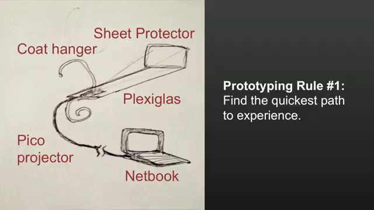
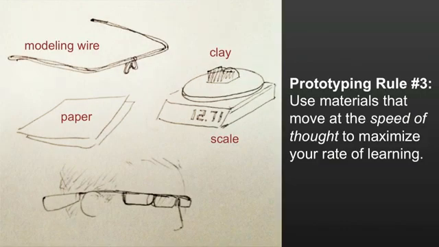

# Chapter 4: Low-fi Prototyping

Now it's time to actually build the product. But you don't build a product good enough to sell or release right away. You need to test whether the product the design team has designed so far actually delivers the user experience the design team wants. The first step is low-fidelity (low-fi) prototyping. Low-fi prototyping means building, at minimal cost, a prototype through which you can indirectly experience what the product will offer. Through this process, you check at a basic level whether there are problems with the design, and fix them if there are.

## Paper prototypes

A method often used for software products is paper prototyping. In paper prototyping, you build the interface out of paper, and people operate the paper interface by hand to prototype the software. Watching the [paper prototype video of Hanmail](https://youtu.be/GrV2SZuRPv0) (a Korean email service) will make it intuitively clear. In the video, there is an interface made of paper, and the user operates it by hand. Then another person plays the computer and changes the interface. Through this process, you can check early in the design what it's like to use the product and whether there are usability problems.

## Experience prototyping

If the product includes physical elements (spaces or objects), it may be hard to deliver the full user experience with a paper prototype alone. In the case of `Experience Coffee`, too, the problem itself is tied up with the space, so even when testing a low-fi prototype, you need to consider how real users move through the café. A design method suited to this kind of situation is [experience prototyping](https://dl.acm.org/doi/pdf/10.1145/347642.347802). Experience prototyping means quickly and easily experiencing a simple version of the experience you want to design. Through it, you can judge in advance whether the experience you ultimately want to design is the one the design team wants. When the [Palm Pilot](<https://en.wikipedia.org/wiki/Palm_(PDA)>) was being built, mobile devices weren't widespread yet, so no one could know what using a PDA would be like. To _prototype_ that experience, [Jeff Hawkins reportedly carried around a block of wood of a similar size and used it as if it were a working Palm Pilot](https://albertosavoia.medium.com/the-palm-pilot-story-1a3424d2ffe4). Google Glass was also designed through [a similar design process](https://youtu.be/d5_h1VuwD6g). There is also the concept of [rapid prototyping](https://maze.co/blog/rapid-prototyping/), whose ultimate aim is similar.

For `Experience Coffee`, you could prototype the experience like this. Stick QR codes printed on paper at the café entrance and on the tables. When a team member playing a customer scans a QR code, they are handed the order screen of a paper prototype and place an order, and another team member passes the order on to the staff. Do this in the real store at weekday lunchtime, when customers pile in. This way you can check things you can't learn from the screens alone, such as whether customers notice the QR code, where they wait after ordering, and whether the staff can handle in-person orders and mobile orders together.

## Usability testing

Once you've built a prototype, you need to evaluate its usability through it. Usability here means usability in a broad sense. The evaluation should cover everything from finding problems with the interface to assessing the idea itself.

As with the other processes, what matters in usability testing is making the purpose clear. That determines what questions to ask and how to run the test. The general frame is to have participants use the prototype and to answer the design team's questions through them. The design team can ask participants questions directly or observe them.

If this is your first usability test, try the following steps. Let's assume you've made the mobile order screens of `Experience Coffee` as a paper prototype.

1. **Recruit participants.** Recruit about five people who fit the target users. For `Experience Coffee`, that's office workers who visit the café at weekday lunchtime. [About five people will reveal most of the big usability problems](https://www.nngroup.com/articles/why-you-only-need-to-test-with-5-users/). Testing with a few people and fixing things over several rounds is better than one test with many people.
2. **Prepare task scenarios.** Don't say "Try it out"; give a specific task. For example: "You've come with a coworker after lunch. Order one iced americano and one hot latte to go." Describe only the goal to achieve, without telling them button names or how to operate anything.
3. **Have them think aloud.** Ask participants to say whatever comes to mind as they use the prototype. This is called [thinking aloud](https://www.nngroup.com/articles/thinking-aloud-the-1-usability-tool/). From muttering like "Where do I choose to-go?" you can learn where participants get stuck and why.
4. **Never help the participants.** Before you start, tell them that it's the prototype being tested, not them. And even if they get lost, don't explain or give hints. Participants often ask questions; when they do, don't answer, and say you'll answer after the test. The reason not to help is that the purpose of usability testing is to find out where participants struggle.
5. **Record and organize.** One person runs the session and another records what they observe. With a paper prototype, you also need someone to play the computer. After the test, gather the problems you found and sort them by severity. For example, a problem that kept several participants from finishing their order and a problem that made someone hesitate for a moment differ in severity.

If you want to know more methods, it's good to consult books mentioned earlier, such as *Universal Methods of Design* and *User Research*.

If usability testing or experience prototyping turns up problems, you need to revise the product design and repeat this process until the critical problems, the ones that keep users from completing their tasks, are solved. Rather than trying to remove every minor problem, it's more realistic to prioritize the problems and solve them in order.

## Constraints

Building a product comes with many constraints. If you're building a sub-product within an existing product, there will naturally be constraints from the parent product. Imagine building a sub-product called Stories in Instagram. You can't build a product that breaks out of Instagram's own frame. It's the same when building a new product from zero. You may lack the technical capability, you may not have the capital, or you may be short on time. The resources for building a product are always limited. In this way, constraints are an inseparable part of design. You may think constraints make design hard, but without constraints there would be no need for design. Design is the process of finding the best answer within constraints.

So at what stage should you consider these constraints? It's good to consider constraints gradually as you flesh out the product. The starting point is the first prototyping. While prototyping, think about which constraints we have that can't change, and prototype with them in mind. In the Google Glass example, clay is used to mimic the electronic parts that would go into Google Glass, and that plays an important role in the design of Google Glass from the start. They don't prototype assuming that, as if by magic, the computer and battery all fit inside ordinary glasses. On the other hand, if you consider too many constraints too early in the design process, it can be hard to develop new ideas. In the Google Glass example, they consider only roughly how heavy the electronic parts are, and don't go as far as designing what shape they should take to attach to the glasses. That can be decided at a later stage. They stop at finding out where on the glasses the parts should go. In this way, you should prototype with the right level of constraints in mind. Later in the design process, you should keep designing while gradually applying more constraints.

