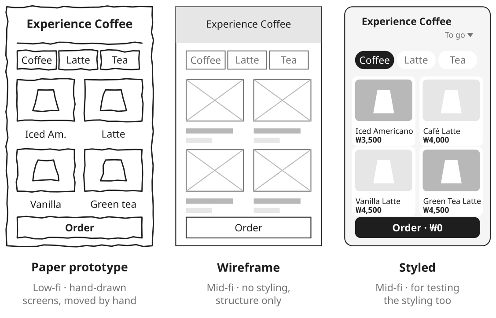

# Chapter 5: Mid-fi Prototyping

If you set the basic frame of the product with a low-fi prototype, you design the details with a mid-fidelity (mid-fi) prototype. In this process, you build a prototype closer to the real product and run usability tests. It's generally good to use a prototyping tool such as [Figma](https://www.figma.com/) at this stage. These tools let you easily build prototypes close to the real product without coding. High-fidelity (high-fi) prototypes, which are almost indistinguishable from the real product, are covered in the next chapter.

You may wonder how close to the real thing you should make it at this stage. That depends on what you need to test. If you need to test the interface's information structure or test it at the component level, it's fine to use [a bare-bones interface with no styling](https://www.figma.com/community/file/1075811850250564922/paper-wireframe-kit). But if you judge that styling matters to the user experience, you should build a mid-fi prototype with the styling you intend to implement.

Your company may have a design system. A design system is a collection of rules and components for using interface elements such as colors, fonts, and buttons consistently. Even without a design system, there may be interface components that have already been built. Since such materials let you build a mid-fi prototype quickly and easily, you'll want to use them. But I recommend not using them at this stage. This may sound like it contradicts what I said above about applying styling if styling matters. But applying styling yourself, only as much as the part you're testing needs, is different from taking finished components as they are. If you bring in finished components, the whole interface looks finished, including the parts that haven't been decided yet. What matters is that unfinished parts should look unfinished.

There are two reasons I don't recommend using a design system at this stage. First, if the prototype looks finished, it's hard for people giving feedback to tell what can still be changed and what can't. Then, even if there's something they'd like to change, they may not say so because it already looks finished, and it's hard to get broad feedback. Second, you may get tied to the existing frame, and a better design may never emerge. You lose the chance to think things through. This is one of the [limitations of design systems](https://youtu.be/BQXTt-NZ2Bs). This is the stage to explore the interface freely, and, if the existing design system's limits show, to decide to improve it.

## Usability testing

Usability testing is needed with mid-fi prototypes too. Here, you should evaluate the usability of more detailed parts than in low-fi usability testing. The process itself isn't very different from the one for low-fi prototypes. To stress it once more: if you find usability issues at this stage, you need to go back, improve the prototype, and repeat the usability test.
