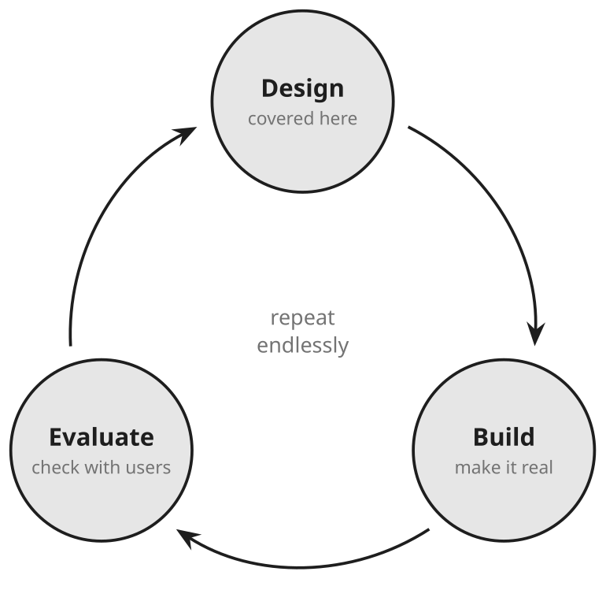

# Chapter 9: An Endless Process

Once you've written the report, you might think you're done. But building a product is an endless process. Put simply, building a product means repeating three steps over and over: design, build, and evaluate. Wrapping up with a report, as above, can be seen as completing one cycle. Even after going through every step, the product will surely have various usability or technical problems. Each time, you need to improve the product by repeating the design, build, and evaluate steps.

The prototype evaluations covered in this booklet are evaluations done within the design step, to refine the design. The evaluation in the cycle means seeing how real users use the product you've built. So what you need to do after closing this booklet is build the product you've designed, evaluate it with real users, and then come back to the first step with the results. It's tedious, but if you keep repeating it until you're sick of it, you'll finally end up with a product worth using.
