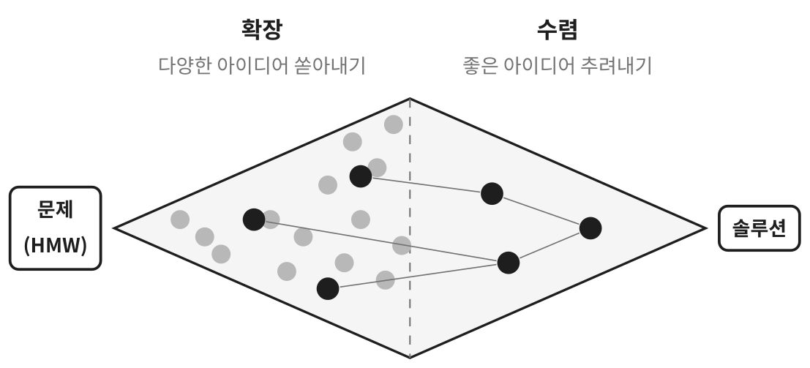
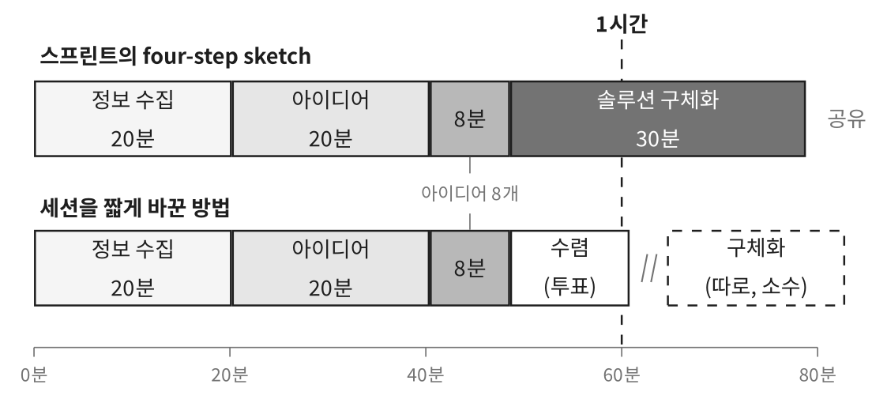
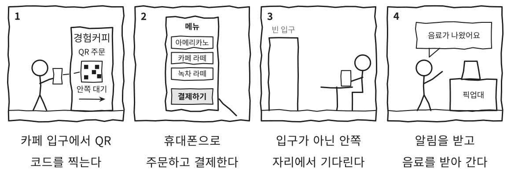

# Chapter 3: 솔루션 및 사용자 경험 스케치

이 단계는 창의적인 생각들을 쏟아내고, 스케치를 통해서 소통하면서 좋은 제품의 컨셉을 찾아 나가는 단계이다. 어떤 제품을 만들면 앞에서 이야기한 문제를 해결할 수 있을지 고민하고 (솔루션) 그 제품을 통해 문제가 해결된 모습이 우리가 원하는 모습인지 (사용자 경험) 확인한다.

## 솔루션 스케치

솔루션을 도출하는 과정은 창의적인 생각을 해야 하는 과정이다. 창의적인 생각을 돕는 방법들도 많이 존재한다. [창의적 도구 세트 (Creative Toolkits)](http://designmethod.korea.ac.kr/design-method/creative-toolkit/)를 활용하거나 [바디스토밍 (Bodystorming)](http://designmethod.korea.ac.kr/design-method/bodystorming/)과 같은 기법을 활용할 수도 있다. 하지만 이러한 기법보다 더 근본적인 접근은 **발산과 수렴**이다. 발산은 다양한 아이디어들을 쏟아내는 과정이고 수렴은 좋은 아이디어들을 추려내는 과정이다. 다양한 디자인 방법론들은 이 두 과정을 더 쉽게 해준다. 발산과 수렴이라는 틀 아래 다양한 기법들을 차용하거나 만들어서 시도해 보면 좋다.

'[스프린트](https://product.kyobobook.co.kr/detail/S000000597320)' 책에서 `four-step sketch`라는 유용한 방법을 제시한다. 총 네 단계로 이루어지는데 먼저 20분 동안 주요 정보들을 수집하고, 러프한 아이디어들을 20분 동안 생각한 후에, 8분 동안 8개의 서로 다른 아이디어들을 구체화한 후, 마지막으로 30분 동안 더 구체적인 하나의 솔루션을 만든다. 이렇게 하고 나서 서로 아이디어를 공유한다.

하지만 이 방법에 단점이 있다면 세션이 길어진다는 것이다. 스프린트의 경우 5일 내내 세션이 진행되는 구조라 이렇게 디자인되었지만 보통의 상황에서는 미팅이 1시간이 넘어가면 집중력을 잃게 되거나 1시간 이상 회의 자체가 어려울 수도 있다. 특히 참가하는 사람이 많은 경우에는 그렇다.

그러한 경우 이 과정을 살짝 변형할 수 있다. 8개의 서로 다른 아이디어들을 만드는 단계까지만 진행하고 세션에 참가한 다양한 사람들의 의견을 수렴하는 것이다. 수렴을 위해서는 친화도 다이어그램을 사용하거나 투표 방식을 활용할 수도 있다. 이렇게 한 후에 구체화 작업은 별도의 시간에 소수의 사람들이 집중해서 하는 것도 가능하다. 스프린트를 하지 않는 상황에서는 이 방법이 더 현실적일 수 있다.

스케치는 스케치다워야 한다. 큰 노력을 들이지 않아야 하며 쉽게 버릴 수 있어야 하지만 핵심 아이디어는 표현이 되어야 한다. 스케치에 대해서도 깊게 이야기 하려면 얼마든지 가능하다. 스케치의 중요성과 역할이 궁금하다면 '[사용자 경험 스케치 - 빌 벅스턴](https://product.kyobobook.co.kr/detail/S000001469856)'을 읽어보길 추천한다.

`경험커피`의 예시로 돌아가 보자. 디자인팀은 앞에서 선택한 세 개의 HMW 질문을 놓고 아이디어를 발산했다. 소형 키오스크를 카페 안쪽에 두는 것, 줄 서는 위치를 바닥에 표시하는 것, 진동벨을 나눠 주는 것, 고객이 자신의 휴대폰으로 QR 코드를 찍어서 주문하는 것과 같은 아이디어들이 나왔다. 투표를 통해 수렴한 결과 디자인팀은 모바일 QR 주문을 선택했다. 고객이 카페 밖이나 안쪽 자리 어디에서든 주문할 수 있어서 세 질문에 모두 답할 수 있고, 공간이 협소하고 키오스크 구매가 부담스럽다는 `경험커피`의 사정에도 맞기 때문이다. 사장님이 처음 이야기한 것은 키오스크였지만, 사용자를 이해하고 문제를 다시 정의하니 다른 솔루션에 도달한 것이다.

## 사용자 경험 스케치

위 과정에서 도출하는 솔루션은 대략적인 제품의 모습이 된다. 그러면 그 제품이 어떠한 사용자 경험을 만들 수 있는지도 설계해 보고 그것이 좋은 사용자 경험이 될지 판단하는 과정이 필요하다. 이를 위해서 우리는 경험을 스케치할 필요가 있다. 제품이 어떻게 생겼을지 파악하기 위해서 제품을 스케치를 하는 것처럼 경험이 어떤 모습일지 파악하기 위해서 경험을 스케치하는 것이다.

경험을 스케치하기 위해서 유용한 방법은 [스토리보드](https://www.nngroup.com/articles/storyboards-visualize-ideas/)를 그려보는 것이다. 스토리보드는 제품이 완성되었을 때 사용자의 경험을 만화와 같이 컷 단위의 스케치로 그리는 것을 이야기한다.

`경험커피`의 모바일 QR 주문이라면 다음과 같은 스토리보드를 그릴 수 있다.

스토리보드를 그려 보면 솔루션만 볼 때는 보이지 않던 질문들이 드러난다. 손님이 입구에서 QR 코드를 발견할 수 있을까? 주문을 마친 손님은 어디에서 기다려야 하는지 알 수 있을까? 음료가 나왔다는 것은 어떻게 알릴까? 이런 질문들이 다음 단계인 프로토타이핑에서 확인해야 하는 것들이 된다.
